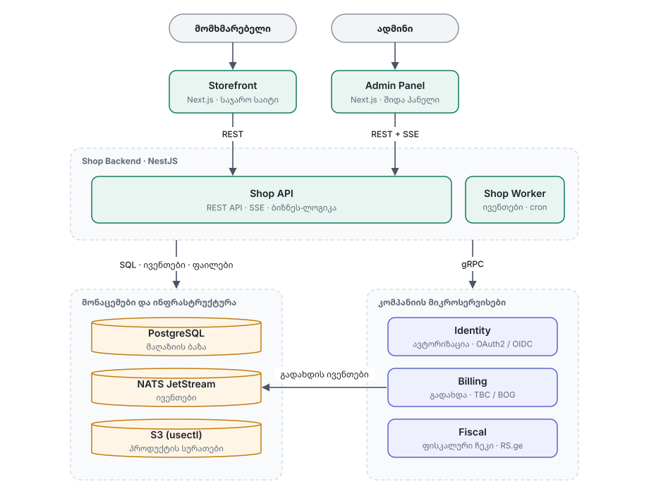
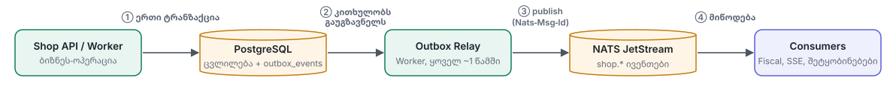
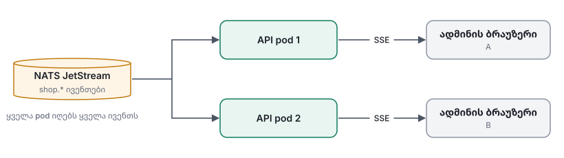

# 02 — Architecture

## 1. სისტემის სქემა



## 2. კომპონენტები

| კომპონენტი | პასუხისმგებლობა |
|---|---|
| **Storefront** | საჯარო საიტი: რენდერი (SSR/ISR), login (BFF), API-ს გამოძახება |
| **Admin Panel** | შიდა პანელი: იგივე login, მხოლოდ ადმინის როლებისთვის |
| **Shop API** | REST API: კატალოგი, კალათა, checkout, შეკვეთები, admin ოპერაციები, SSE ნაკადები |
| **Shop Worker** | ფონური სამუშაო: NATS ივენთები, outbox, ვადაგასული რეზერვაციები, ფისკალური ჩეკები |
| **PostgreSQL** | მაღაზიის ყველა საკუთარი მონაცემი |
| **NATS JetStream** | ივენთები სერვისებს შორის |
| **S3** | პროდუქტის სურათები (usectl-ის S3 addon) |
| **Identity** | კომპანიის მიკროსერვისი: მომხმარებლები, login, ტოკენები, როლები |
| **Billing** | კომპანიის მიკროსერვისი: გადახდა TBC / BOG-ით, refund, გადახდის ივენთები |
| **Fiscal** | კომპანიის მიკროსერვისი: ფისკალური ჩეკები RS.ge-ზე |

API და Worker **ერთი კოდბაზაა** (`icomers-api` რეპო) ორი გამშვები ფაილით. Deploy ცალ-ცალკე ხდება, რომ HTTP და ფონური სამუშაო ერთმანეთს არ დატვირთონ.

## 3. NestJS მოდულები (modular monolith)

Shop backend არის **ერთი აპლიკაცია, შიგნით მკაცრად დაყოფილი მოდულებად**. კომპანიის მიკროსერვისების სისტემაში ის ერთი სერვისია, რომელიც დანარჩენებს gRPC-ით და NATS-ით ესაუბრება.

```
icomers-api/src/
  modules/
    auth/            # JWT ვალიდაცია (JWKS), Guards, @CurrentUser, @Roles
    catalog/         # კატეგორიები, პროდუქტები, სურათები, ძებნა
    compatibility/   # დამტენის ბრენდები, მოდელები, product ↔ model კავშირი
    inventory/       # მარაგი, მოძრაობები, რეზერვაციები
    customers/       # პროფილი, მისამართები
    cart/            # კალათა (guest + user), შერწყმა login-ისას
    orders/          # შეკვეთები, სტატუსები, state machine
    checkout/        # checkout: ფასი → რეზერვაცია → გადახდა
    payments/        # Billing adapter, გადახდის ივენთები
    fiscal/          # Fiscal adapter, ჩეკები
    admin-events/    # SSE ნაკადები
    audit/           # admin audit log
  infra/             # prisma, nats, outbox, grpc, storage
  main.ts            # HTTP API
  worker.ts          # Worker
```

**წესები მოდულებს შორის:**
- მოდული სხვა მოდულის ცხრილებს პირდაპირ არ ეხება. სხვა მოდულის მონაცემს მხოლოდ მისი service-ით იღებს. ამის წყალობით, საჭიროებისას ნებისმიერი მოდული შეიძლება ცალკე სერვისად გამოიყოს.
- კომპანიის მიკროსერვისებთან (Billing, Fiscal, Identity) ინტეგრაცია ხდება **adapter-ის** მეშვეობით (`PaymentGateway`, `FiscalGateway`, `IdentityGateway` ინტერფეისები). Adapter-ს ორი იმპლემენტაცია აქვს: **gRPC** (რეალური სერვისი) და **mock** (ლოკალური დეველოპმენტი და ავტომატური ტესტები). ასე ბიზნეს-ლოგიკა gRPC კონტრაქტის დეტალებზე არ არის დამოკიდებული, და კონტრაქტის ცვლილება მხოლოდ adapter-ს ეხება.

## 4. როდის sync, როდის async

| სიტუაცია | გზა | მაგალითი |
|---|---|---|
| პასუხი **ახლავე** გვჭირდება | **gRPC** | გადახდის შექმნა და redirect URL-ის მიღება |
| რაღაც „მოხდა“ და სხვებმა უნდა გაიგონ | **NATS** | `shop.order.paid` |
| ერთად უნდა მოხდეს ან საერთოდ არ მოხდეს | **Postgres ტრანზაქცია** | შეკვეთა + მარაგის რეზერვაცია + outbox ჩანაწერი |
| ბრაუზერმა live უნდა დაინახოს | **SSE** | ახალი შეკვეთა ადმინის dashboard-ზე |

### ძირითადი წესები
- **ბიზნეს-ლოგიკა მხოლოდ NestJS-შია.** Next.js ასრულებს მხოლოდ რენდერს და login-ის (BFF) როლს.
- ფრონტი gRPC-ს და NATS-ს არ ეხება, მხოლოდ REST-ს და SSE-ს.
- **მარაგი ყოველთვის ტრანზაქციაში იცვლება**, შეკვეთასთან ერთად. ასინქრონულად არასდროს.
- ფასი, დღგ და ჯამი ყოველთვის სერვერზე ითვლება.
- ყველა NATS consumer **idempotent** არის: ერთი ივენთი შეიძლება ორჯერ მოვიდეს და შედეგი ერთი უნდა იყოს.

## 5. Outbox pattern

პრობლემა: შეკვეთა ბაზაში ჩაიწერა, მაგრამ NATS-ში ივენთის გაგზავნამდე სერვერი გაითიშა, და ივენთი დაიკარგა.

გამოსავალი: ივენთი ჯერ ბაზაში იწერება, იმავე ტრანზაქციაში, შემდეგ კი Worker მას NATS-ში აგზავნის.



<details>
<summary>ტექნიკური დეტალები</summary>

- `Nats-Msg-Id` = ივენთის id. თუ relay ერთ ივენთს ორჯერ გააგზავნის, JetStream მეორეს უგულებელყოფს.
- Relay კითხულობს `SELECT … WHERE published_at IS NULL FOR UPDATE SKIP LOCKED`-ით, რომ რამდენიმე Worker-მა ერთი ივენთი ერთდროულად არ აიღოს.
- Idempotent consumer:
  ```
  BEGIN
    INSERT INTO processed_events(event_id, consumer) … ON CONFLICT DO NOTHING
    -- უკვე არსებობდა → უკვე დამუშავებულია → ack და გასვლა
    … ბიზნეს-ლოგიკა …
  COMMIT
  ack()
  ```

</details>

## 6. SSE (live განახლებები)

SSE გამოიყენება ორ ადგილას: **ადმინის dashboard** (ახალი შეკვეთები, გადახდები, გაფრთხილებები) და **checkout-ის შედეგის გვერდი** (შეკვეთის სტატუსი გადახდის შემდეგ).



თითოეული API pod NATS-ის ივენთებს თავად იღებს და თავის ბრაუზერებს გადასცემს. ასე ყველა ადმინი ყველა ივენთს ხედავს, მიუხედავად იმისა, რომელ pod-ზე მოხვდა.

### SSE-ის წესები
- **ივენთი შეიძლება დაიკარგოს.** კავშირის გაწყვეტისას გამოტოვებული ივენთები აღარ ბრუნდება. ამიტომ ყოველი ხელახალი მიერთების შემდეგ კლიენტი ერთხელ REST-იდან ხელახლა ტვირთავს მონაცემებს (reconcile). Polling არ გამოიყენება.
- **Reconnect:** ექსპონენციალური backoff 1 წამიდან 30 წამამდე, jitter-ით.
- **Heartbeat:** სერვერი ყოველ 15 წამში აგზავნის `: ping` კომენტარს, რომ proxy-მ კავშირი არ გათიშოს.
- **Cache-ის განახლება:** ივენთი პირდაპირ აახლებს TanStack Query-ის cache-ს (`setQueriesData`), ამიტომ დამატებითი request არ ხდება.
- **Optimistic update არ ხდება.** მოქმედება (მაგ. გადახდა) აბრუნებს „მიღებულია“ პასუხს, ხოლო რეალური სტატუსი მხოლოდ SSE-ით ან REST-ით მოდის.
- **Proxy:** usectl-ზე ტრაფიკი Cloudflare-ით და Traefik-ით გადის. heartbeat კავშირს ღიად ინახავს; დეტალები: [Deployment](10-deployment.md#4-sse-usectl-ზე).
- ივენთების სახელები `snake_case`-ითაა: `order_created`, `order_paid`, `order_status_changed`, `inventory_low_stock`.

### SSE და ავტორიზაცია: ორი ვარიანტი

ბრაუზერის ჩვეულებრივი `EventSource` ვერ აგზავნის `Authorization` header-ს. ამის გადასაჭრელად ორი გზა არსებობს:

| | **ვარიანტი A: BFF + cookie** (რეკომენდებული) | **ვარიანტი B: Bearer token + polyfill** (როგორც ev-charger-admin-შია) |
|---|---|---|
| როგორ მუშაობს | ტოკენი Next.js-ის სერვერზე ინახება, ბრაუზერში მხოლოდ httpOnly cookie-ა. SSE ჩვეულებრივი `EventSource`-ით მიდის Next.js-ზე, რომელიც მას API-ზე გადასცემს ტოკენით | ტოკენი ბრაუზერშია. SSE `event-source-polyfill`-ით იხსნება, რომელიც `Authorization: Bearer` header-ს აგზავნის |
| ტოკენის განახლება | Next.js-ის სერვერი აკეთებს, ერთ ადგილას, ყველა request-ისთვის | SSE სერვისს საკუთარი 401 → refresh ლოგიკა სჭირდება, axios interceptor-ისგან ცალკე |
| უსაფრთხოება | ტოკენი JavaScript-ისთვის მიუწვდომელია, ამიტომ XSS-ით ვერ მოიპარება | ტოკენი JavaScript-შია, ამიტომ XSS-ის რისკი მეტია |
| დამატებითი ბიბლიოთეკა | არ სჭირდება | polyfill |

**რეკომენდაცია: ვარიანტი A.** მიზეზები:
1. **მაღაზია საჯარო საიტია**, სადაც მომხმარებლები ბარათით იხდიან. ტოკენის httpOnly cookie-ში შენახვა XSS-ისგან იცავს.
2. **ტოკენის განახლება ერთ ადგილასაა.** ვარიანტ B-ში ის ორ ადგილას უნდა დაიწეროს (ჩვეულებრივი request-ები და SSE), და ზედმეტი refresh-ებისგანაც დაცვა სჭირდება.
3. **კოდი მარტივია:** ჩვეულებრივი `EventSource` ავტომატური reconnect-ით, polyfill-ის გარეშე.
4. Next.js უკვე გვაქვს სერვერად, ამიტომ BFF დამატებით ინფრასტრუქტურას არ მოითხოვს.

ვარიანტი B ბუნებრივია ისეთი აპისთვის, რომელიც მხოლოდ ბრაუზერში მუშაობს და სერვერული ნაწილი არ აქვს (მაგ. Vite SPA). ჩვენს შემთხვევაში Next.js-ის სერვერი ამ პრობლემას ხსნის.

## 7. gRPC client-ის წესები

- ყველა call-ს აქვს **deadline** (3–5 წამი). უსასრულო ლოდინი დაუშვებელია.
- Retry მხოლოდ წაკითხვაზე ან იმ call-ებზე, რომლებიც idempotency key-ს იღებენ (მაგ. გადახდის შექმნა `order_id`-ით).
- gRPC შეცდომები HTTP-ად გარდაიქმნება: `UNAVAILABLE` → 503, `INVALID_ARGUMENT` → 422, `NOT_FOUND` → 404.
