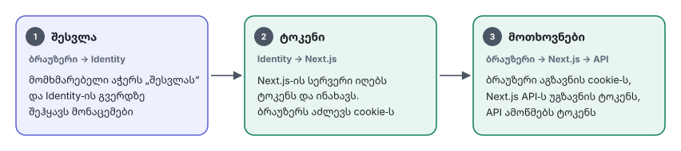

# 03 — Integrations

ქვემოთ მოცემული gRPC მეთოდები აღწერს, რა ფუნქციონალი სჭირდება მაღაზიას. ზუსტი სახელები და ველები შეთანხმდება შესაბამისი სერვისის `.proto` კონტრაქტის მიხედვით.

## სერვისების გამოყენება

| სერვისი | როგორ ვიყენებთ |
|---|---|
| **Identity** | Login და რეგისტრაცია (OAuth2 / OIDC), ტოკენის შემოწმება, ადმინის როლები |
| **Billing** | gRPC: გადახდის შექმნა, refund. NATS: გადახდის შედეგი |
| **Fiscal** | gRPC Worker-იდან: გაყიდვისა და დაბრუნების ჩეკები |
| **Notification** | მოგვიანებით. ამჟამად push-ისთვისაა, მობილური აპი კი არ იგეგმება |

---

## 1. Identity — OAuth2 / OIDC

**რაც უკვე ვიცით** (კომპანიის სხვა პროექტებიდან): Identity იყენებს OAuth2-ს, access token არის **JWT**, მომხმარებლის ID არის `sub` claim (UUID), refresh token მხარდაჭერილია. მაღაზიაში `customers.identity_user_id = sub`.

**რაც დამატებით გვჭირდება:** OAuth2 გვეუბნება, რა უფლება აქვს ტოკენს. იმის გასაგებად, **ვინ არის მომხმარებელი** (სახელი, email), საჭიროა **OpenID Connect (OIDC)**, რომელიც OAuth2-ის თავზე დგას.

| საჭიროება | რატომ |
|---|---|
| OIDC Discovery / issuer URL | endpoint-ების ავტომატური აღმოჩენა |
| Authorization Code + PKCE | ბრაუზერისთვის უსაფრთხო login flow |
| JWKS endpoint | Shop API ტოკენს თავად ამოწმებს, Identity-ზე ყოველი request-ის გარეშე |
| `roles` claim | ადმინის როლები: `admin`, `manager`, `content_editor`, `warehouse` |
| ორი client | `icomers-storefront` და `icomers-admin`, თავ-თავისი redirect URI-ებით |
| Audience (`aud`) | `icomers-api`, რომ სხვა სერვისის ტოკენი ჩვენთან არ იმუშაოს |

:::question id="identity-oidc" to="Identity გუნდი"
ზემოთ ცხრილში ჩამოთვლილიდან რომელი არის მხარდაჭერილი (OIDC discovery, PKCE, JWKS, `roles` claim, audience)? შეგიძლიათ დაარეგისტრიროთ ორი client (`icomers-storefront`, `icomers-admin`) და შექმნათ ადმინის როლები? გთხოვთ, მიუთითოთ issuer URL (dev / staging / prod).
:::

:::question id="identity-login-ui" to="Identity გუნდი"
Login / რეგისტრაციის გვერდი Identity-ის hosted გვერდია? აქვს ქართული ენა და ბრენდინგის შეცვლის შესაძლებლობა? რეგისტრაცია email-ით, ტელეფონით (SMS) თუ ორივეთი?
:::

:::question id="platform-s2s-auth" to="Platform / Backend გუნდი"
Service-to-service ავთენტიფიკაცია gRPC-ზე როგორ ხდება: **mTLS**, **service token**, თუ შიდა ქსელში ავთენტიფიკაციის გარეშე?
:::

### Login flow (BFF)



- ტოკენები ინახება Next.js-ის სერვერზე. ბრაუზერში მხოლოდ httpOnly cookie-ა, `localStorage` არ გამოიყენება. რატომ: იხ. [SSE და ავტორიზაცია](02-architecture.md#sse-და-ავტორიზაცია-ორი-ვარიანტი).
- Shop API ამოწმებს JWT-ს (ხელმოწერა JWKS-ით, `iss`, `aud`, `exp`) და როლებს (`RolesGuard`).
- პირველი login-ისას Shop API ქმნის `customers` ჩანაწერს `sub`-ით.
- Checkout მოითხოვს login-ს. კალათა login-ის გარეშეც მუშაობს და login-ისას ერწყმის. საბოლოო გადაწყვეტილება: კითხვა `biz-guest-checkout`.

---

## 2. Billing — TBC / BOG

### gRPC მეთოდები

| მეთოდი | შემავალი | გამომავალი |
|---|---|---|
| `CreatePayment` | `idempotency_key` (= `order_id`), `amount_minor`, `currency`, `provider` (TBC / BOG), `return_url` | `payment_id`, `status`, `redirect_url` |
| `GetPayment` | `payment_id` | `status`, `amount_minor` |
| `RefundPayment` | `payment_id`, `amount_minor`, `idempotency_key` | `refund_id`, `status` |

### ივენთები (Billing → NATS)

Billing უკვე აქვეყნებს გადახდის შედეგს NATS-ში. მაღაზია ამ ივენთებს მუდმივი (durable) consumer-ით იღებს:

| ივენთი | მაღაზიის რეაქცია |
|---|---|
| გადახდა წარმატებულია | შეკვეთა → `PAID`, მარაგი ჩამოიჭრება, ჩეკი გამოიწერება |
| გადახდა ჩავარდა | შეკვეთა → `PAYMENT_FAILED`, მარაგი თავისუფლდება |
| refund დასრულდა | refund → `SUCCEEDED`, დაბრუნების ჩეკი |

:::question id="billing-events" to="Billing გუნდი"
გადახდის ივენთების **ზუსტი subject-ები და payload-ის სქემა** (წარმატებული / წარუმატებელი / refund)? როგორ გადავცეთ `order_id`, რომ ივენთში დაგვიბრუნდეს? ბანკის callback-ს Billing იღებს?
:::

:::question id="billing-idempotency" to="Billing გუნდი"
`CreatePayment` არის idempotent? ანუ ერთი და იგივე `idempotency_key`-ით ორი გამოძახება ერთ გადახდას ქმნის?
:::

:::question id="billing-refund" to="Billing გუნდი"
შესაძლებელია **ნაწილობრივი refund**? დაახლოებით რამდენ დღეში ბრუნდება თანხა ბარათზე (მომხმარებლისთვის ტექსტში დასაწერად)?
:::

:::question id="billing-expiry" to="Billing გუნდი"
რამდენ ხანში ითვლება გადაუხდელი გადახდა **ვადაგასულად**? ამაზეა დამოკიდებული მარაგის რეზერვაციის ვადა (ახლა 15 წუთი).
:::

:::question id="billing-sandbox" to="Billing გუნდი"
არსებობს **sandbox / test** გარემო TBC-სა და BOG-ისთვის staging-ზე გამოსაყენებლად?
:::

:::question id="billing-methods" to="Billing გუნდი / ბიზნესი"
გადახდის რომელი მეთოდებია ხელმისაწვდომი: მხოლოდ ბარათი, თუ Apple Pay / Google Pay / განვადებაც? რომელი გვინდა პირველ ვერსიაში?
:::

---

## 3. Fiscal — RS.ge

| მეთოდი | რისთვის |
|---|---|
| `IssueReceipt` | გაყიდვის ჩეკი: ხაზები (სახელი, რაოდენობა, ფასი, დღგ), ჯამი, გადახდის ტიპი |
| `IssueRefundReceipt` | დაბრუნების ჩეკი, ორიგინალ ჩეკზე მითითებით |

**როდის იძახება:** Worker იღებს `shop.order.paid` ივენთს და იძახებს `IssueReceipt`-ს. შეცდომისას ცდილობს ხელახლა; თუ მრავალჯერადი მცდელობა ჩავარდა, ჩეკი `FAILED` ხდება და ადმინი იღებს გაფრთხილებას „თავიდან ცდის“ ღილაკით.

:::question id="fiscal-sync" to="Fiscal გუნდი"
Fiscal ჩეკის ნომერს **სინქრონულად** აბრუნებს gRPC პასუხში, თუ **ასინქრონულად** (საკუთარი NATS ივენთით)?
:::

:::question id="fiscal-when" to="ბუღალტერია"
ფისკალური ჩეკი **გადახდის მომენტში** უნდა გამოიწეროს, თუ **ნივთის გადაცემისას**?
:::

:::question id="fiscal-fields" to="Fiscal გუნდი"
რა ველებს ითხოვს `IssueReceipt` (საქონლის კოდები, ერთეულები, დღგ-ის კოდები, გადახდის ტიპი)? შეიძლება მომხმარებელს ჩეკის ბმული ან PDF ვაჩვენოთ? გთხოვთ, მოგვაწოდოთ მაგალითი.
:::

---

## 4. შეტყობინებები (email / SMS)

შეკვეთის დადასტურება და სტატუსის ცვლილება მომხმარებელს ორი გზით შეიძლება მივაწოდოთ:
- **A:** Notification სერვისს ემატება email/SMS არხი (ცენტრალიზებული, კომპანიის ყველა სერვისისთვის)
- **B:** Worker პირდაპირ იყენებს email provider-ს და ქართულ SMS provider-ს

ორივე შემთხვევაში წყარო ივენთია: `shop.order.paid`, `shop.order.status_changed`.

:::question id="notif-channel" to="Backend გუნდი / ბიზნესი"
შეკვეთის შეტყობინებები რომელი არხით წავიდეს (email, SMS, ორივე) და საიდან: Notification სერვისი გაფართოვდება (A), თუ მაღაზია პირდაპირ provider-ს გამოიყენებს (B)?
:::

---

## 5. NATS JetStream

Stream: `SHOP`, subjects `shop.>`. მაღაზიის მიერ გამოქვეყნებული ივენთები:

| Subject | როდის | ვინ ისმენს |
|---|---|---|
| `shop.order.created` | შეკვეთა შეიქმნა (გადახდამდე) | admin SSE |
| `shop.order.paid` | გადახდა დადასტურდა | Worker (ჩეკი), შეტყობინებები, admin SSE |
| `shop.order.status_changed` | ადმინმა სტატუსი შეცვალა | შეტყობინებები, admin SSE |
| `shop.order.cancelled` | შეკვეთა გაუქმდა | Worker (refund), admin SSE |
| `shop.order.refunded` | თანხა დაბრუნდა | Worker (დაბრუნების ჩეკი), admin SSE |
| `shop.inventory.low_stock` | მარაგი ზღვარს ქვემოთ ჩავიდა | admin SSE |
| `shop.product.updated` | პროდუქტი შეიცვალა | storefront-ის განახლება |

ყველა ივენთის ფორმატი (ველები `snake_case`):

```json
{
  "id": "0192f3c4-…",
  "type": "shop.order.paid",
  "version": 1,
  "occurred_at": "2026-10-13T10:15:00Z",
  "source": "icomers-api",
  "data": { "order_id": "…", "order_number": "ICM-000123", "total_minor": 15900, "currency": "GEL" }
}
```

ივენთის სტრუქტურის ცვლილებისას `version` იზრდება, ძველი ველები კი არ იშლება.

<details>
<summary>ტექნიკური დეტალები: consumer-ის პარამეტრები და proto ფაილები</summary>

| პარამეტრი | მნიშვნელობა |
|---|---|
| ტიპი | durable, pull |
| `ack_policy` | explicit |
| `ack_wait` | 30s |
| `max_deliver` | 10 |
| `backoff` | 1s, 5s, 30s, 2m, 10m … |
| ამოწურვის შემდეგ | `failed_events` ცხრილი + გაფრთხილება ადმინში |

`.proto` კონტრაქტები ინახება `icomers-api/proto/`-ში, TypeScript კოდი მათგან Buf + ts-proto-ით გენერირდება. ივენთების სქემები `icomers-api/src/contracts/`-შია (zod), რომ publisher-იც და consumer-იც ერთსა და იმავეს იყენებდნენ.

</details>

:::question id="proto-source" to="Backend გუნდი"
სად ინახება Identity / Billing / Fiscal სერვისების `.proto` კონტრაქტები და როგორ მივიღოთ მათზე წვდომა (რეპო, Buf registry)?
:::

NATS-თან და კომპანიის სერვისებთან ქსელური კავშირი: იხ. კითხვა `platform-company-services` ([Deployment](10-deployment.md#11-platform-თან-დასაზუსტებელი)).
