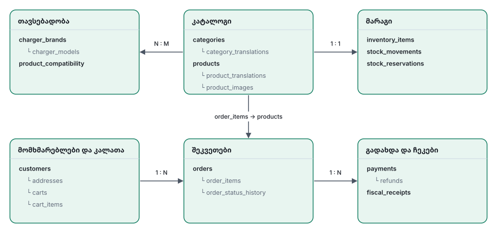

# 04 — Data Model (PostgreSQL)

## 1. კონვენციები

| წესი | მნიშვნელობა |
|---|---|
| Primary key | `uuid` (`gen_random_uuid()`), გარდა join ცხრილებისა |
| სახელები | `snake_case` (ბაზაშიც და API-შიც) |
| დრო | `timestamptz`, UTC. ყველა ცხრილს აქვს `created_at`, `updated_at` |
| თანხა | `integer`, **თეთრებში** (`*_minor`). ვალუტა `GEL` |
| ენები | თარგმნადი ტექსტი ინახება `*_translations` ცხრილებში (`locale` = `ka` / `en`) |
| წაშლა | პროდუქტი არ იშლება, ხდება `ARCHIVED` (შეკვეთებს სჭირდებათ). დანარჩენი: hard delete, სადაც უსაფრთხოა |
| Snapshot | შეკვეთა ინახავს პროდუქტის სახელს, ფასს და მისამართს **იმ მომენტის მდგომარეობით**. შემდგომი ცვლილებები ძველ შეკვეთებს არ ცვლის |
| Extensions | `pgcrypto`, `pg_trgm`, `citext` |

## 2. დომენები და კავშირები



## 3. ცხრილები

### კატალოგი

**`categories`**
| სვეტი | ტიპი | შენიშვნა |
|---|---|---|
| id | uuid PK | |
| parent_id | uuid FK → categories, null | ხე (მაგ. „კაბელები“ → „Type 2 კაბელები“) |
| slug | text UNIQUE | URL-ისთვის, ერთი ორივე ენისთვის (ლათინური) |
| sort_order | int | |
| is_active | bool | |

**`category_translations`**: `(category_id, locale)` PK, `name`, `description`, `seo_title`, `seo_description`

**`products`**
| სვეტი | ტიპი | შენიშვნა |
|---|---|---|
| id | uuid PK | |
| sku | text UNIQUE | შიდა კოდი |
| slug | text UNIQUE | |
| category_id | uuid FK | |
| status | enum `DRAFT` / `ACTIVE` / `ARCHIVED` | storefront-ზე ჩანს მხოლოდ `ACTIVE` |
| price_minor | int CHECK ≥ 0 | დღგ-ის ჩათვლით |
| compare_at_price_minor | int null | „ძველი ფასი“ (გადახაზული) |
| vat_rate_bp | int default 1800 | დღგ basis points-ში (18.00%) |
| oem_part_numbers | text[] | ქარხნული ნომრები, ძებნისთვის |
| attributes | jsonb | თავისუფალი მახასიათებლები: `{ "voltage": "400V", "current": "32A", "connector": "Type 2" }` |
| weight_g | int null | მომავალი მიწოდებისთვის |
| is_featured | bool | მთავარ გვერდზე |
| created_at, updated_at | timestamptz | |

**`product_translations`**
| სვეტი | ტიპი | შენიშვნა |
|---|---|---|
| product_id, locale | PK | |
| name | text | |
| short_description | text | |
| description | text | Markdown / rich text |
| seo_title, seo_description | text | |
| search_vector | tsvector GENERATED | `to_tsvector('simple', name ‖ short_description)` |

**`product_images`**: `id`, `product_id`, `storage_key`, `alt` (jsonb `{ka,en}`), `sort_order`, `width`, `height`

**`attribute_definitions`** *(სურვილისამებრ, ფილტრებისთვის)*: `key`, `label` (jsonb), `type` (`text`/`number`/`enum`), `options`, `is_filterable`. საშუალებას აძლევს ადმინს, თავად განსაზღვროს, რომელი `attributes` გამოჩნდეს ფილტრად.

### თავსებადობა

**`charger_brands`**: `id`, `slug` UNIQUE, `name`, `logo_key`, `sort_order`, `is_active`

**`charger_models`**
| სვეტი | ტიპი | შენიშვნა |
|---|---|---|
| id | uuid PK | |
| brand_id | uuid FK | |
| slug | text | UNIQUE `(brand_id, slug)` |
| name | text | მაგ. „Wallbox Pulsar Plus“ |
| revision | text null | ვერსია / რევიზია / თაობა |
| power_kw | numeric null | |
| image_key | text null | რომ მომხმარებელმა ვიზუალურად იცნოს |
| is_active | bool | |

**`product_compatibility`**
| სვეტი | ტიპი | შენიშვნა |
|---|---|---|
| product_id | uuid FK | PK `(product_id, charger_model_id)` |
| charger_model_id | uuid FK | |
| note | text null | მაგ. „მხოლოდ 2023 წლის შემდეგ გამოშვებულ ვერსიაზე“ |

ინდექსი: `(charger_model_id, product_id)`, რადგან ფილტრი სწორედ ამ მიმართულებით მუშაობს.

> **უნივერსალური ნაწილები** (რომლებიც ყველა მოდელს ერგება): `products.is_universal bool`. ფილტრი აბრუნებს `compatible OR universal`.

### მარაგი (ერთი საწყობი)

**`inventory_items`**
| სვეტი | ტიპი | შენიშვნა |
|---|---|---|
| product_id | uuid PK FK | |
| on_hand | int | ფიზიკურად საწყობშია |
| reserved | int | დაკავებულია გადაუხდელი შეკვეთებით |
| low_stock_threshold | int default 2 | |
| | CHECK | `on_hand >= 0 AND reserved >= 0 AND reserved <= on_hand` |

ხელმისაწვდომი = `on_hand - reserved`.

**`stock_movements`** (ledger, მხოლოდ INSERT)
| სვეტი | ტიპი | შენიშვნა |
|---|---|---|
| id | uuid | |
| product_id | uuid | |
| type | enum `RECEIPT` / `SALE` / `RETURN` / `ADJUSTMENT` / `DAMAGE` | |
| quantity | int | + ან − |
| order_id | uuid null | |
| reason | text null | |
| actor_id | text null | ადმინის identity id |
| created_at | timestamptz | |

**`stock_reservations`**: `id`, `order_id`, `product_id`, `quantity`, `status` (`ACTIVE` / `COMMITTED` / `RELEASED`), `expires_at`, ინდექსი `(status, expires_at)`

### მომხმარებლები

**`customers`** (Identity-ის მონაცემების ლოკალური ასლი + მაღაზიის მონაცემები)
| სვეტი | ტიპი | შენიშვნა |
|---|---|---|
| id | uuid | |
| identity_user_id | text UNIQUE | `sub` ტოკენიდან |
| type | enum `INDIVIDUAL` / `BUSINESS` | `BUSINESS` მოგვიანებით |
| email | citext null | |
| phone | text null | |
| first_name, last_name | text | |
| preferred_locale | text default `ka` | |
| created_at, updated_at | | |

**`addresses`**: `id`, `customer_id`, `label`, `recipient_name`, `phone`, `city`, `address_line`, `notes`, `is_default`

> **B2B მომავლისთვის:** დაემატება `business_profiles` (`customer_id`, `company_name`, `tax_id`, `legal_address`), `price_lists` და `price_list_items`. ახლანდელი სქემა ამას არ ეწინააღმდეგება.

### კალათა

**`carts`**: `id`, `customer_id` UNIQUE null, `guest_token` UNIQUE null, `updated_at`, `expires_at`. CHECK: ერთ-ერთი მაინც შევსებულია.

**`cart_items`**: `(cart_id, product_id)` PK, `quantity` CHECK > 0, `added_at`

ფასი კალათაში **არ ინახება**. ის ყოველთვის `products`-იდან იკითხება.

### შეკვეთები

**`orders`**
| სვეტი | ტიპი | შენიშვნა |
|---|---|---|
| id | uuid | |
| number | text UNIQUE | ადამიანისთვის წაკითხვადი: `ICM-000123` (sequence) |
| customer_id | uuid FK | |
| status | enum | იხ. [06-order-flow](06-order-flow.md#1-შეკვეთის-სტატუსები) |
| fulfillment_method | enum `PICKUP` / `DELIVERY` | `DELIVERY` ადმინის მიერ ხელით იმართება |
| contact | jsonb | snapshot: სახელი, ტელეფონი, email |
| shipping_address | jsonb null | snapshot |
| subtotal_minor | int | |
| shipping_minor | int default 0 | |
| discount_minor | int default 0 | |
| total_minor | int | |
| vat_minor | int | ჯამში შემავალი დღგ |
| currency | char(3) default `GEL` | |
| locale | text | რა ენაზე გაფორმდა (შეტყობინებებისთვის) |
| customer_note | text null | |
| internal_note | text null | მხოლოდ ადმინისთვის |
| placed_at, paid_at, completed_at, cancelled_at | timestamptz null | |

**`order_items`**: `id`, `order_id`, `product_id`, `sku`, `name` (jsonb `{ka,en}` snapshot), `unit_price_minor`, `quantity`, `vat_rate_bp`, `line_total_minor`

**`order_status_history`**: `id`, `order_id`, `from_status`, `to_status`, `actor_type` (`SYSTEM` / `CUSTOMER` / `ADMIN`), `actor_id`, `comment`, `created_at`

### გადახდა და ჩეკები

**`payments`**: `id`, `order_id`, `provider` (`TBC` / `BOG`), `billing_payment_id` UNIQUE, `status` (`PENDING` / `SUCCEEDED` / `FAILED` / `EXPIRED`), `amount_minor`, `redirect_url`, `last_event` jsonb, timestamps

**`refunds`**: `id`, `payment_id`, `billing_refund_id`, `amount_minor`, `status`, `reason`, `actor_id`, timestamps

**`fiscal_receipts`**: `id`, `order_id`, `type` (`SALE` / `REFUND`), `status` (`PENDING` / `ISSUED` / `FAILED`), `external_id`, `receipt_url`, `error`, `attempts`, `issued_at`

### ტექნიკური ცხრილები

| ცხრილი | რისთვის |
|---|---|
| `outbox_events` | `id`, `aggregate_type`, `aggregate_id`, `event_type`, `payload` jsonb, `created_at`, `published_at` null, `attempts`. ინდექსი: `WHERE published_at IS NULL` |
| `processed_events` | `(event_id, consumer)` PK, `processed_at`. Idempotent consumer |
| `failed_events` | ივენთები, რომლებმაც `max_deliver` ამოწურეს |
| `idempotency_keys` | `key`, `customer_id`, `request_hash`, `response` jsonb, `created_at`. `POST /checkout`-ისთვის |
| `admin_audit_log` | `id`, `actor_id`, `actor_email`, `action`, `entity_type`, `entity_id`, `diff` jsonb, `ip`, `created_at` |

## 4. მნიშვნელოვანი query-ები

### თავსებადობის ფილტრი
```sql
SELECT p.*
FROM products p
WHERE p.status = 'ACTIVE'
  AND (p.is_universal
       OR EXISTS (SELECT 1 FROM product_compatibility pc
                  WHERE pc.product_id = p.id AND pc.charger_model_id = $1));
```

### ძებნა (ქართული + ინგლისური + SKU / OEM)
ძებნა მუშაობს Postgres-ის full-text search-ით (`simple` კონფიგურაცია) და `pg_trgm`-ით (მსგავსი სიტყვები, შეცდომით აკრეფილი სიტყვები), SKU-ითა და OEM ნომრით.

<details>
<summary>ტექნიკური დეტალები: ინდექსები და query</summary>

```sql
-- ინდექსები
CREATE INDEX ON product_translations USING gin (search_vector);
CREATE INDEX ON product_translations USING gin (name gin_trgm_ops);
CREATE INDEX ON products USING gin (sku gin_trgm_ops);
CREATE INDEX ON products USING gin (oem_part_numbers);

-- query (მარტივი ვერსია)
SELECT p.id, similarity(t.name, $q) AS score
FROM products p
JOIN product_translations t ON t.product_id = p.id AND t.locale = $locale
WHERE p.status = 'ACTIVE'
  AND ( t.search_vector @@ plainto_tsquery('simple', $q)
     OR t.name % $q
     OR p.sku ILIKE $q || '%'
     OR $q = ANY(p.oem_part_numbers) )
ORDER BY score DESC
LIMIT 20;
```

</details>

### მარაგის უსაფრთხო რეზერვაცია (race condition-ის გარეშე)
```sql
UPDATE inventory_items
SET reserved = reserved + $qty, updated_at = now()
WHERE product_id = $id
  AND on_hand - reserved >= $qty
RETURNING product_id;
-- 0 row → მარაგი არ არის → მთელი checkout ტრანზაქციის rollback
```
