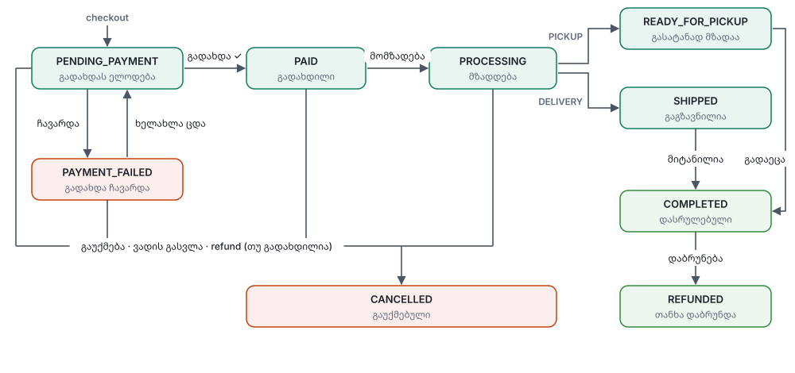
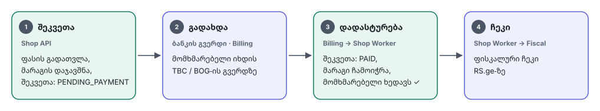
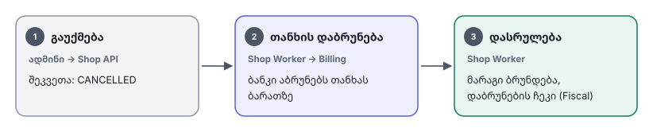

# 06 — Order Flow (Checkout, გადახდა, ჩეკი)

## 1. შეკვეთის სტატუსები



- დასაშვები გადასვლები აღწერილია **ერთ ადგილას** (`orders/order-state-machine.ts`). ყველა სხვა გადასვლა → `409 INVALID_TRANSITION`.
- ყოველი გადასვლა იწერება `order_status_history`-ში და outbox-ში (`shop.order.status_changed`).

## 2. Checkout — ნაბიჯ-ნაბიჯ



### მნიშვნელოვანი დეტალები
1. **ფასი ყოველთვის სერვერზე ითვლება.** კლიენტიდან მოსული ფასი არასდროს გამოიყენება. `expected_total_minor` მხოლოდ შედარებისთვისაა.
2. **რეზერვაცია ტრანზაქციაშია.** თუ ერთ-ერთ ხაზზე მარაგი არ ჰყოფნის, მთელ ტრანზაქციას უკეთდება rollback → `409 OUT_OF_STOCK` დეტალებით.
3. **თუ `CreatePayment` ჩავარდა** (Billing მიუწვდომელია): შეკვეთა რჩება `PENDING_PAYMENT`, მომხმარებელი ხედავს „სცადეთ თავიდან“ (`retry-payment`). რეზერვაცია ძალაში რჩება ვადის გასვლამდე.
4. **Idempotency-Key:** იგივე key-ით მეორე request (ორმაგი დაწკაპუნება, refresh) აბრუნებს იმავე პასუხს და ახალ შეკვეთას არ ქმნის.
5. **დაბრუნების გვერდი** არ ენდობა URL-ის პარამეტრებს („success=true“). სტატუსს იღებს ჩვენი API-დან: ჯერ REST-ით, შემდეგ ელოდება ცვლილებას SSE-ით. ხელახლა დაკავშირებისას სტატუსს ისევ REST-ით ამოწმებს.

## 3. რეზერვაციის ვადა

- `RESERVATION_TTL` = 15 წუთი (კონფიგურირებადი; Billing-ის გადახდის ვადაზე ოდნავ მეტი უნდა იყოს).
- Worker-ის cron ყოველ წუთს:
  ```sql
  SELECT ... FROM stock_reservations
  WHERE status = 'ACTIVE' AND expires_at < now()
  FOR UPDATE SKIP LOCKED
  ```
  → `reserved -= qty`, reservation → `RELEASED`, შეკვეთა → `CANCELLED` (reason: `PAYMENT_TIMEOUT`).

### Edge case: გადახდა მოვიდა რეზერვაციის ვადის გასვლის შემდეგ
1. თუ მარაგი ჯერ კიდევ ხელმისაწვდომია → შეკვეთა აღდგება და ხდება `PAID` (ჩვეულებრივი გზა).
2. თუ მარაგი აღარ არის → შეკვეთა `PAID`, მაგრამ მოინიშნება როგორც `needs_attention`. ადმინი SSE-ით იღებს გაფრთხილებას და წყვეტს, დაელოდოს მარაგს თუ დააბრუნოს თანხა.

## 4. გაუქმება და Refund



- მარაგი ავტომატურად ბრუნდება მხოლოდ მაშინ, თუ ნივთი ჯერ არ გაცემულა (`PAID` / `PROCESSING`). `COMPLETED`-ის შემდეგ დაბრუნებისას ადმინი ნივთის შემოწმების შემდეგ ხელით აფორმებს `RETURN` მოძრაობას.
- ნაწილობრივი refund: მხოლოდ admin როლით და მხოლოდ იმ შემთხვევაში, თუ Billing ამას მხარს უჭერს.

## 5. ფისკალური ჩეკი

| სიტუაცია | ქმედება |
|---|---|
| `shop.order.paid` | `IssueReceipt` (SALE) |
| `shop.order.refunded` | `IssueRefundReceipt` (REFUND) |
| Fiscal მიუწვდომელია | JetStream retry backoff-ით |
| `max_deliver` ამოიწურა | `fiscal_receipts.status = FAILED`, ადმინს ეგზავნება გაფრთხილება, ჩნდება ღილაკი „თავიდან ცდა“ |

ჩეკის გამოწერის მომენტი (გადახდისას თუ გადაცემისას) დამოკიდებულია `fiscal-when` კითხვის პასუხზე, იხ. [03 §3](03-integrations.md#3-fiscal--rsge).

## 6. შეტყობინებები მომხმარებელს (როცა არხი გადაწყდება)

| ივენთი | შეტყობინება |
|---|---|
| `shop.order.paid` | „შეკვეთა ICM-000123 მიღებულია“ + ჩეკის ბმული |
| `status_changed → READY_FOR_PICKUP` | „შეკვეთა მზადაა, შეგიძლიათ წაიღოთ“ + მისამართი/საათები |
| `status_changed → SHIPPED` | „შეკვეთა გზაშია“ |
| `shop.order.cancelled` | „შეკვეთა გაუქმდა, თანხა დაგიბრუნდებათ X დღეში“ |
