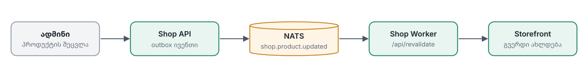

# 07 — Storefront (Next.js)

## 1. ტექნოლოგიები
- Next.js App Router, React Server Components
- Tailwind CSS (+ shadcn/ui საბაზისო კომპონენტებისთვის)
- **next-intl**: ka / en, locale URL-ში
- API client: `openapi-fetch` + `icomers-api`-ის `openapi.json`-იდან გენერირებული ტიპები
- Auth: Auth.js (OIDC) ან `openid-client`, BFF pattern (იხ. [03 §1](03-integrations.md#1-identity--oauth2--oidc))
- ფორმები: react-hook-form + zod
- Client state: მინიმალური. კალათის რაოდენობა header-ში → TanStack Query ან Server Actions + `revalidatePath`

## 2. გვერდები (routes)

| Route | გვერდი | Rendering |
|---|---|---|
| `/[locale]` | მთავარი: hero, „აირჩიე შენი დამტენი“, კატეგორიები, featured | ISR (5 წთ + on-demand) |
| `/[locale]/catalog` | ყველა პროდუქტი + ფილტრები | SSR (ფილტრები URL-შია) |
| `/[locale]/c/[...slug]` | კატეგორია | ISR + SSR ფილტრებით |
| `/[locale]/p/[slug]` | პროდუქტის გვერდი | **ISR**, `revalidateTag('product:{id}')` |
| `/[locale]/chargers` | ბრენდების სია | ISR |
| `/[locale]/chargers/[brand]` | ბრენდის მოდელები | ISR |
| `/[locale]/chargers/[brand]/[model]` | ამ მოდელის თავსებადი ნაწილები (**SEO-სთვის ძალიან მნიშვნელოვანი**) | ISR |
| `/[locale]/search?q=` | ძებნის შედეგები | SSR, `noindex` |
| `/[locale]/cart` | კალათა | Dynamic |
| `/[locale]/checkout` | მიღების მეთოდი, კონტაქტი, გადახდის მეთოდი | Dynamic, login აუცილებელია |
| `/[locale]/checkout/result/[orderId]` | გადახდის შედეგი (SSE ელოდება სტატუსს) | Dynamic |
| `/[locale]/account` | პროფილი | Dynamic, protected |
| `/[locale]/account/orders` | შეკვეთები | Dynamic |
| `/[locale]/account/orders/[id]` | შეკვეთის დეტალები, სტატუსის timeline, ჩეკი | Dynamic |
| `/[locale]/account/addresses` | მისამართები | Dynamic |
| `/[locale]/pages/[slug]` | წესები და პირობები, კონფიდენციალურობა, დაბრუნების პოლიტიკა, მიწოდება/გატანა, კონტაქტი | Static |
| `/api/auth/*` | login / callback / logout (BFF) | Route handlers |
| `/api/revalidate` | API-დან on-demand revalidation (secret-ით) | Route handler |
| `/sitemap.xml`, `/robots.txt` | | generated |

> ⚖️ **სამართლებრივი გვერდები** (წესები, კონფიდენციალურობა, დაბრუნების უფლება) ონლაინ ვაჭრობისთვის აუცილებელია.

:::question id="biz-legal" to="იურისტი / ბიზნესი"
ვინ მოგვაწვდის სამართლებრივ ტექსტებს (წესები და პირობები, კონფიდენციალურობის პოლიტიკა, დაბრუნების პოლიტიკა) ქართულად და ინგლისურად? როდისთვის?
:::

## 3. „ჩემი დამტენი“ (თავსებადობის UX)

1. მთავარ გვერდზე და header-ში: **„აირჩიე შენი დამტენი“** → ბრენდი → მოდელი (სურათებით).
2. არჩეული მოდელი ინახება **cookie-ში** (`my_charger=<modelId>`); ავტორიზებული მომხმარებლისთვის შეიძლება პროფილშიც შეინახოს (რამდენიმე დამტენი, მომავალში).
3. როცა მოდელი არჩეულია:
   - კატალოგი ავტომატურად იფილტრება (chip: „ნაჩვენებია: Wallbox Pulsar Plus ✕“)
   - პროდუქტის ბარათზე badge: ✅ „ერგება შენს დამტენს“ / ⚠️ „არ ერგება“
   - პროდუქტის გვერდზე: სრული სია „თავსებადია შემდეგ მოდელებთან“
4. თუ მომხმარებელმა თავისი მოდელი ვერ იპოვა → ფორმა/ბმული „ვერ იპოვე? დაგვიკავშირდი“.

## 4. ფილტრები (კატალოგი)

| ფილტრი | UI |
|---|---|
| დამტენის მოდელი | ზემოთ ცალკე (იხ. §3) |
| კატეგორია | ხე / chips |
| ფასი | range slider |
| მარაგშია | toggle |
| დინამიური ატრიბუტები (კონექტორი, დენი, სიგრძე...) | checkbox-ები `/catalog/filters`-იდან, რაოდენობებით |
| სორტირება | პოპულარული, ფასი ↑↓, ახალი |

ყველა ფილტრი **URL-შია** (`?category=cables&in_stock=true&attr[connector]=Type+2`), რომ ბმულის გაზიარება და უკან დაბრუნება სწორად მუშაობდეს.

## 5. i18n

- `ka` ნაგულისხმევია: `/` → `/ka`.
- UI ტექსტები: `messages/ka.json`, `messages/en.json`.
- პროდუქტის კონტენტი API-დან მოდის `Accept-Language`-ით.
- თუ ინგლისური თარგმანი აკლია → ქართული იჩვენება (fallback API-ის მხარეს).
- ფასის ფორმატი: `Intl.NumberFormat('ka-GE', { style: 'currency', currency: 'GEL' })`.
- შრიფტი უნდა უჭერდეს მხარს ქართულ ანბანს (მაგ. Noto Sans Georgian, FiraGO, BPG სერია).

## 6. SEO

- `generateMetadata`: title, description, canonical, **hreflang** (`ka`, `en`, `x-default`)
- Open Graph სურათები პროდუქტებისთვის
- JSON-LD: `Product` (`offers`, `price`, `priceCurrency: GEL`, `availability`), `BreadcrumbList`, `Organization`
- `sitemap.xml`: პროდუქტები, კატეგორიები, დამტენის მოდელების გვერდები, ორივე ენაზე
- ძებნისა და ფილტრების კომბინაციების გვერდები: `noindex` ან canonical მთავარ კატეგორიაზე
- სურათები: `next/image`, WebP/AVIF, სწორი `sizes`

## 7. Caching და revalidation

- `fetch(..., { next: { tags: ['product:123'] } })` თითოეულ API call-ზე.
- **ფასი და მარაგი** პროდუქტის გვერდზე ISR-დანაა, მაგრამ კალათაში და checkout-ში **ყოველთვის ახლიდან** მოწმდება.

## 8. ხარისხი

მიზნები: Core Web Vitals-ის „კარგი“ ზონა (LCP < 2.5s), კლავიატურით ნავიგაცია და საკმარისი კონტრასტი (WCAG AA). ანალიტიკა მხოლოდ cookie consent-ის შემდეგ.

:::question id="biz-analytics" to="ბიზნესი / მარკეტინგი"
რომელი ანალიტიკა გამოვიყენოთ: **GA4**, **Plausible**, თუ სხვა? საჭიროა Meta Pixel / სხვა სარეკლამო tracking?
:::

